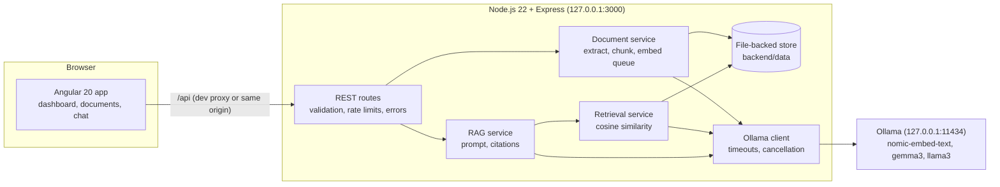

# MediDocs AI: Healthcare Document Intelligence Assistant

A local, private question-answering app for **administrative healthcare documents** (hospital policies, procedures and
synthetic training material). Upload PDFs or text files, ask questions in plain language, and get answers that cite the
exact document and page they came from. Everything runs on your own computer through [Ollama](https://ollama.com): no cloud
AI, no paid API, no Docker, no GPU.

> **Important.** This is a **portfolio demonstration**, not a certified healthcare system. It gives **no medical advice**,
> diagnosis or treatment guidance. It has **no authentication** and listens on `127.0.0.1` only. Use **fictional or public
> documents only, never real patient records.** AI answers can be wrong; always check the cited passages.

**Stack:** Angular 20 (standalone components, signals), Node.js 22 + Express, Ollama (`nomic-embed-text` embeddings,
`gemma3` or `llama3` for answers), file-backed vector store, `pdfjs-dist` for PDF text.

---

## Contents

1. [Verification status (read this first)](#verification-status-read-this-first)
2. [Features](#features)
3. [Architecture](#architecture)
4. [How the RAG pipeline works](#how-the-rag-pipeline-works)
5. [Folder structure](#folder-structure)
6. [Prerequisites](#prerequisites)
7. [Quick start on Windows (ZIP)](#quick-start-on-windows-zip)
8. [Manual setup with exact commands](#manual-setup-with-exact-commands)
9. [Ollama models: check and install](#ollama-models-check-and-install)
10. [Running the app](#running-the-app)
11. [Tests and builds](#tests-and-builds)
12. [Sample documents and expected answers](#sample-documents-and-expected-answers)
13. [Configuration reference](#configuration-reference)
14. [API reference](#api-reference)
15. [Troubleshooting](#troubleshooting)
16. [Security notes and limitations](#security-notes-and-limitations)
17. [Screenshots](#screenshots)
18. [Roadmap](#roadmap)
19. [Portfolio description (resume / LinkedIn)](#portfolio-description-resume--linkedin)
20. [Publishing on GitHub](#publishing-on-github)

---

## Verification status (read this first)

This project was generated and checked in a **Linux sandbox without Ollama, without a browser and without Windows**.
Here is exactly what was and was not verified, so you know what to test on your PC.

| Area | Status |
|---|---|
| Backend unit and API tests (113 tests, `npm test` in `backend/`) | **Passed** in the sandbox. They run the real Express app, upload pipeline, PDF extraction, chunking, retrieval and RAG code against a **test-only mock of the Ollama HTTP API** (`backend/test/helpers/mockOllama.js`). |
| Frontend tests (53 tests, `npm test` in `frontend/`, Vitest + jsdom) | **Passed** in the sandbox. Covers stores, upload flow, polling, chat, citations, error states, markdown sanitising. |
| Angular production build | **Passed**, no warnings. |
| Real backend process serving the built frontend (single-port mode), spaced data path | **Passed** (manual check with curl against a running server). |
| PDF text extraction with page numbers | **Passed** on a generated 3-page PDF; malformed, password-protected and image-only PDFs produce clear errors. |
| **Real Ollama answers** (quality of retrieval thresholds, model output, prompt-injection resistance of your chosen model) | **NOT verified.** No Ollama was available. Run `npm run smoke` and `npm run test:live` on your PC (see below). The default `MIN_SIMILARITY=0.30` is a starting point that you may need to tune. |
| **Windows scripts** (`install.bat`, `start.bat`, `start-production.bat`) | `install.bat` was run by a user on Windows and worked. `start.bat` initially failed because of a bug I introduced (an error message spliced into the normal startup path); that is fixed. Nothing was executed on Windows by me: the scripts were checked with a static lint (all `goto` targets exist, no fall-through into error labels) and a simulated trace of the happy path. Their Node helper scripts were run on Linux. Report any problem you hit. |
| **Visual appearance in a browser** (layout, dark theme, mobile) | **NOT verified visually.** No browser was available, so no screenshots exist. See [Screenshots](#screenshots). |
| Dependency installation on **Windows** | **Failed once in real use**, then fixed: the first ZIP shipped `package-lock.json` files generated on Linux, which lack Windows-only packages (`@rollup/rollup-win32-x64-msvc`), triggering npm bug 4828. The lockfiles were removed and `install.bat` now verifies and self-repairs. Not re-tested on Windows by me. |
| `npm audit` | Production dependencies of backend and frontend: **0 vulnerabilities**. The frontend's *dev-only* test tooling (Vitest 3, pinned by Angular 20's test builder) has advisories; they do not ship in the app. |

## Features

**Dashboard.** Sidebar navigation, summary band (documents, indexed passages, library size, answer model), recent documents,
recent questions, live Ollama and model status with the exact fix commands, skeleton loaders, empty states, toasts,
light and dark themes, responsive layout (off-canvas menu on phones).

**Documents.** Upload PDF and TXT (drag and drop or picker, several files at once). Backend validates extension, MIME
type, magic bytes and size. Table shows name, upload date, size, pages, passage count and live processing status with
progress. Inspect the stored passages of any document, retry failed documents, delete a document together with its
chunks, embeddings and stored file. Uploaded files are stored under random UUID names outside any public folder.

**Chat.** Conversation history (saved in your browser), new/clear conversation, suggested questions, user and assistant
bubbles, safe Markdown rendering, **highlighted citation chips** that open the supporting passage, expandable source
passages with document name and page (or section for TXT) and similarity score, optional scope to a single document,
model picker populated from the models you actually have installed, loading state with **Cancel**, timeouts, and friendly
messages when Ollama is stopped or a model is missing.

**Backend.** REST API with centralized error handling, zod validation, helmet, CORS allow-list, rate limits (stricter on
asking and uploading), safe paths, request logs without bodies, health and Ollama connectivity checks, one-at-a-time
indexing and generation to stay light on 8 GB machines.

## Architecture



The browser never talks to Ollama. Angular only calls `/api/...`; the backend is the single gateway to the model.

## How the RAG pipeline works

```mermaid
flowchart TD
  subgraph Ingestion["Ingestion (once per document)"]
    A["Upload PDF or TXT"] --> B["Validate extension, MIME, magic bytes, size"]
    B --> C["Save as random UUID file in backend/data/uploads"]
    C --> D["Extract text per page (pdfjs-dist) or decode text file"]
    D --> E["Split into overlapping chunks<br/>(never across pages)"]
    E --> F["Embed batches with nomic-embed-text<br/>prefix: search_document:"]
    F --> G["Store text + normalised vectors in backend/data/db"]
  end
  subgraph Query["Question answering"]
    Q["Question"] --> H["Embed with prefix search_query:"]
    H --> I["Cosine similarity against all chunks"]
    I --> J{"Any chunk above MIN_SIMILARITY?"}
    J -- "no" --> K["Answer: not enough information<br/>(model is NOT called)"]
    J -- "yes" --> L["Top K chunks into a fenced prompt"]
    L --> M["Ollama /api/chat (system rules + passages + question)"]
    M --> N{"Model says INSUFFICIENT_INFORMATION?"}
    N -- "yes" --> K
    N -- "no" --> O["Answer + sources (document, page, score, text)"]
  end
```



1. **Extraction.** PDFs are read page by page so every chunk keeps an exact page number. Scanned (image-only) PDFs are
   detected and rejected with an explanation; OCR is out of scope.
2. **Chunking.** Default 1000 characters with 150 characters of overlap, preferring paragraph, then sentence, then word
   boundaries. Overlap starts on a word boundary. Both values are configurable.
3. **Embeddings.** `POST /api/embed` with an array of inputs (Ollama 0.3 and newer). If an old Ollama returns 404 for that
   endpoint the client falls back to the legacy `/api/embeddings` format automatically. `nomic-embed-text` expects task
   prefixes, so `search_document:` / `search_query:` are added (only for nomic models). Vectors are normalised and stored as
   base64 Float32.
4. **Retrieval.** Cosine similarity over all stored chunks in memory (instant at the scale of this demo), top `TOP_K`,
   filtered by `MIN_SIMILARITY`. Chunks embedded with a different model or dimension are ignored.
5. **Generation.** The system message holds the rules; retrieved text goes in the user message inside
   `<passage id=".." document=".." page="..">` fences, followed by the question. Passages are explicitly described as
   untrusted data, and text that imitates the delimiters (`</passage>`, `<system>`) is defused before it is inserted.
   The model must cite `[n]` and reply `INSUFFICIENT_INFORMATION` when the passages are not enough.
6. **Post-processing.** The backend detects which `[n]` markers the model actually used and flags sources as cited or
   merely retrieved, converts an insufficient reply to a standard message, and flags answers with no citations so the UI can
   warn the user. Every response carries a disclaimer.

## Folder structure

```
MediDocs-AI/
├── install.bat                  one-time dependency install + .env creation + Ollama check
├── start.bat                    dev mode: backend and Angular dev server in two windows
├── start-production.bat         single-process mode: builds once, backend serves UI + API
├── README.md  LICENSE  package.json  .gitignore  .gitattributes  .editorconfig
├── .github/workflows/ci.yml     backend + frontend tests and build on GitHub Actions
├── backend/
│   ├── .env.example             all settings, documented
│   ├── scripts/                 preflight.js, smoke-test.js, wait-for.js, print-port.js
│   ├── src/
│   │   ├── server.js app.js     process entry and Express app
│   │   ├── config/              validated environment configuration (zod)
│   │   ├── routes/              system, documents, chat (thin handlers)
│   │   ├── middleware/          errorHandler, rateLimit, upload, requestLogger
│   │   ├── services/            ollama, extract, chunker, embeddings, retrieval, rag, documentService, container
│   │   ├── storage/             documentStore (atomic JSON files)
│   │   └── utils/               paths, fsx, vector, text, validation, queue, http
│   ├── test/
│   │   ├── unit/                runs without Ollama (uses a mock Ollama HTTP server)
│   │   ├── live/                needs real Ollama; auto-skipped otherwise
│   │   ├── helpers/ fixtures/   mock server, sample PDFs (valid, malformed, encrypted, scanned)
│   └── data/                    created at runtime, git-ignored (uploads/, db/)
├── frontend/                    Angular 20 app (src/app/core, shared, pages)
├── sample-documents/            fictional policies + expected-questions.json
└── docs/screenshots/            screenshot checklist (no images yet)
```

## Prerequisites

* Windows 10 or 11 (the app itself is plain Node.js and also runs on macOS and Linux with the manual commands).
* **Node.js 22.12 or newer 22.x LTS** (or 24+). Angular 20 refuses older versions. Check with `node --version`.
* **Ollama** for Windows, installed and running: <https://ollama.com/download>
* Models already pulled: `nomic-embed-text` plus `gemma3` and/or `llama3` (commands below).
* A current Chrome, Edge or Firefox.
* About 8 GB RAM. No GPU needed.

**No lockfiles are shipped on purpose.** npm bug 4828 breaks installs when a lockfile created on one operating system is
used on another (Angular's build tools have per-OS native packages). Without a lockfile npm picks the right binaries for your
machine. Once you have installed on your own PC you may commit your own `package-lock.json`, but then do not share it across operating systems.

**Native build tools: none required.** Every dependency ships prebuilt binaries for Windows (Angular's esbuild and
file-watcher packages, pdf.js's optional canvas package). The backend uses plain JSON files for storage, so there is no
SQLite/native module to compile.

## Quick start on Windows (ZIP)

1. Extract `MediDocs-AI.zip`, for example to `D:\projects\MediDocs-AI` (spaces in the path are fine).
2. Make sure Ollama is running and the models are pulled (next section).
3. Double-click **`install.bat`** once. It checks Node.js, runs `npm install` in `backend` and `frontend`, creates
   `backend\.env`, and checks Ollama. It never downloads models.
4. Double-click **`start.bat`**. It checks Ollama and the models, opens two windows (backend, frontend), waits until both
   answer, and opens <http://localhost:4200>.
5. Go to **Documents**, upload the files from `sample-documents\`, wait for **Ready**, then open **Ask questions**.

`start.bat force` starts even if the Ollama check fails. For lower memory use, run **`start-production.bat`** instead: it
builds the Angular app once and serves everything from the backend at <http://127.0.0.1:3000> with a single Node process.

This is not a one-click install: Node.js, Ollama and the model downloads are prerequisites you must do yourself.

## Manual setup with exact commands

PowerShell or Command Prompt, from the project folder:

```powershell
node --version          # must print v22.12.0 or newer
cd backend
npm install
Copy-Item .env.example .env
cd ..\frontend
npm install
```

If PowerShell blocks `npm` ("running scripts is disabled"), either use Command Prompt (`cmd`) or run
`Set-ExecutionPolicy -Scope CurrentUser RemoteSigned` once.

## Ollama models: check and install

```powershell
ollama --version
ollama list                      # shows installed models
ollama pull nomic-embed-text     # required: embeddings (small, ~270 MB)
ollama pull gemma3               # chat model, recommended on 8 GB RAM (~3.3 GB)
ollama pull llama3               # optional second chat model (~4.7 GB, slower on 8 GB)
```

The app never downloads models by itself. `start.bat`, `/api/health` and the Dashboard tell you exactly which `ollama pull`
command is missing. Tips for 8 GB RAM: keep only one chat model loaded (`setx OLLAMA_MAX_LOADED_MODELS 1`, then restart
Ollama), close other heavy programs, prefer `gemma3`, and use `start-production.bat`. The first question after starting
Ollama is slow because the model has to load; later ones are faster.

## Running the app

Development mode (two terminals):

```powershell
# terminal 1
cd backend
npm start                # http://127.0.0.1:3000  (npm run dev restarts on file changes)

# terminal 2
cd frontend
npm start                # http://localhost:4200  (proxies /api to the backend)
```

Single-process mode:

```powershell
cd frontend
npm run build
cd ..\backend
npm start                # serves the UI and API at http://127.0.0.1:3000
```

Health check: <http://127.0.0.1:3000/api/health>. If you change `PORT` in `backend\.env`, `start.bat` passes the new port to
the Angular proxy automatically; when starting the frontend by hand set `MEDIDOCS_API_PORT` first
(`$env:MEDIDOCS_API_PORT=3001` in PowerShell).

## Tests and builds

| What | Command (folder) | Needs Ollama? |
|---|---|---|
| Backend unit + API tests | `npm test` (`backend`) | No (uses a mock Ollama server) |
| Frontend tests | `npm test` (`frontend`) | No |
| Everything | `npm test` (project root) | No |
| Live RAG tests against real Ollama | `npm run test:live` (`backend`) | **Yes**, auto-skipped otherwise |
| End-to-end smoke test of a running app | `npm run smoke` (`backend`, backend must be running) | **Yes** |
| Production build | `npm run build` (`frontend`) | No |

**What the tests cover.** Chunking (size, overlap, page attribution, edge cases), cosine similarity and ranking, upload
validation (extension, MIME, signature, size, binary, empty, hostile file names), PDF extraction (valid, malformed,
encrypted, image-only), the document store (restart persistence, corruption recovery, atomic writes, path safety), Ollama
client (connection failure, timeout, cancellation, missing model, legacy embedding endpoint), RAG prompt construction and
prompt-injection fencing, API errors and rate limits, deletion cleanup, security headers, frontend stores and key UI flows.

**Mock vs real.** The `unit` tests prove the plumbing works. They cannot prove that real models retrieve and answer well;
the mock's embeddings are word-hash vectors. Use `npm run smoke` for that. It uploads the sample documents (or reuses them),
asks all questions in `sample-documents/expected-questions.json`, prints answer, sources and scores, **fails** if an expected
passage is not retrieved, and only **warns** if the model's wording differs.

```powershell
cd backend
npm start                 # in one terminal
npm run smoke -- --cleanup   # in another; --cleanup removes the documents it uploaded
npm run smoke -- --model llama3:latest
```

## Sample documents and expected answers

See [`sample-documents/README.md`](sample-documents/README.md) for the full table of 12 questions with the document, page and
text each answer must be grounded in, including two questions that must produce "not enough information" and one
prompt-injection test document.

## Configuration reference

All settings live in `backend/.env` (copy of `.env.example`). Invalid values stop the server at startup with a clear message.

| Variable | Default | Meaning |
|---|---|---|
| `PORT` | `3000` | Backend port (bound to 127.0.0.1) |
| `CORS_ORIGIN` | `http://localhost:4200,http://127.0.0.1:4200` | Comma-separated allowed browser origins |
| `OLLAMA_BASE_URL` | `http://127.0.0.1:11434` | Ollama address. `127.0.0.1` avoids IPv6 `localhost` problems on Windows |
| `OLLAMA_CHAT_MODEL` | `gemma3:latest` | Default chat model |
| `OLLAMA_EMBED_MODEL` | `nomic-embed-text:latest` | Embedding model. Changing it requires re-uploading documents |
| `ALLOWED_CHAT_MODELS` | `gemma3,llama3` | Models the UI may offer and the API accepts (embedding models are never allowed) |
| `OLLAMA_EMBED_TIMEOUT_MS` | `120000` | Timeout per embedding request |
| `OLLAMA_CHAT_TIMEOUT_MS` | `240000` | Timeout for generating an answer (max 290000) |
| `DATA_DIR` | `./data` | Storage folder (relative to `backend/`, or an absolute path, spaces allowed) |
| `MAX_UPLOAD_MB` | `10` | Upload size limit |
| `MAX_PDF_PAGES` | `300` | PDF page limit |
| `CHUNK_SIZE` / `CHUNK_OVERLAP` | `1000` / `150` | Passage size and overlap in characters (overlap at most half of size) |
| `TOP_K` | `4` | Passages sent to the model |
| `MIN_SIMILARITY` | `0.30` | Minimum cosine similarity. **Tune for your models** |
| `EMBED_BATCH_SIZE` | `8` | Chunks per embedding request |
| `CHAT_NUM_CTX` | `4096` | Context window requested from Ollama |
| `RATE_LIMIT_API_PER_MINUTE` | `300` | General API limit per client |
| `RATE_LIMIT_ASK_PER_MINUTE` | `12` | Questions per minute |
| `RATE_LIMIT_UPLOAD_PER_MINUTE` | `20` | Uploads per minute |
| `FRONTEND_DIST` | `../frontend/dist/medidocs/browser` | Built UI served in single-port mode if present |
| `LOG_REQUESTS` | `true` | One log line per request (never bodies or file contents) |

**Tuning `MIN_SIMILARITY`.** If the app says "not enough information" for questions you know are covered, lower it (try
`0.20`). If clearly unrelated passages reach the model, raise it (try `0.40`). The smoke test prints the best score per
question to help you choose.

## API reference

Base URL `http://127.0.0.1:3000/api`. All responses are JSON. Errors always look like:

```json
{ "error": { "code": "MODEL_NOT_FOUND", "message": "The chat model \"llama3:latest\" is not installed. Run: ollama pull llama3:latest" } }
```

| Method and path | Purpose | Notes |
|---|---|---|
| `GET /health` | API and Ollama status | Always 200; `ollama.reachable`, `ollama.ready`, `missingModels` |
| `GET /models` | Installed chat models the UI may offer | 503 `OLLAMA_UNAVAILABLE` if Ollama is down |
| `GET /settings` | Safe public settings (limits, retrieval values) | No paths or secrets |
| `GET /stats` | Document counts by status, chunk and byte totals | |
| `GET /documents` | List documents | |
| `POST /documents` | Upload one file, multipart field `file` | `202` with the document in `queued` state. 400 `NO_FILE`/`EMPTY_FILE`, 413 too large, 415 wrong type/MIME/signature, 422 empty text |
| `GET /documents/:id` | Document details | 404 `DOCUMENT_NOT_FOUND` |
| `GET /documents/:id/status` | Processing status | `status` is `queued`, `processing`, `ready` or `failed`; `stage`, `progress {done,total}`, `error` |
| `GET /documents/:id/chunks?offset=0&limit=20` | Stored passages of a document | limit 1 to 100 |
| `GET /documents/:id/chunks/:index` | One passage with its document name and page | 404 `CHUNK_NOT_FOUND` |
| `POST /documents/:id/retry` | Re-process a failed document | 409 if not failed |
| `DELETE /documents/:id` | Delete document, chunks, embeddings and stored file | |
| `POST /chat/ask` | Ask a question | Body below |

**Ask request**

```json
{ "question": "What is the late cancellation fee for an MRI?", "model": "gemma3:latest", "documentIds": ["optional-uuid"] }
```

`question` 3 to 1000 characters; `model` optional (must be installed and allowed); `documentIds` optional scope.

**Ask response**

```json
{
  "answer": "Imaging appointments require 48 hours' notice and a USD 50 late cancellation fee applies [1].",
  "grounded": true,
  "reason": "OK",
  "model": "gemma3:latest",
  "sources": [
    { "ref": 1, "documentId": "…", "documentName": "Riverside-Appointment-and-Cancellation-Policy.pdf",
      "page": 2, "chunkIndex": 2, "score": 0.71, "text": "…", "cited": true }
  ],
  "retrieval": { "searchedChunks": 21, "topK": 4, "minSimilarity": 0.3, "bestScore": 0.71 },
  "timings": { "retrievalMs": 150, "generationMs": 9200 },
  "disclaimer": "AI-generated from the retrieved passages and may be wrong. …"
}
```

`reason` is `OK`, `NO_CITATIONS` (answer given but no `[n]` used), `LOW_SIMILARITY` (nothing relevant; model not called),
`MODEL_INSUFFICIENT` (model said the passages are not enough) or `NO_DOCUMENTS`.

**Common error codes:** `VALIDATION_ERROR` 400, `INVALID_JSON` 400, `MODEL_NOT_ALLOWED` 400, `PAYLOAD_TOO_LARGE` 413,
`UNSUPPORTED_EXTENSION` / `MIME_MISMATCH` / `INVALID_PDF_SIGNATURE` 415, `RATE_LIMITED` 429, `MODEL_NOT_FOUND` 502,
`OLLAMA_UNAVAILABLE` 503, `OLLAMA_TIMEOUT` 504. Document processing failures (stored on the document) include `PDF_INVALID`,
`PDF_ENCRYPTED`, `PDF_NO_TEXT`, `PDF_TOO_MANY_PAGES` and `EMPTY_DOCUMENT`.

## Troubleshooting

**Port already in use.** `EADDRINUSE` / "Port 3000 is already in use":
```powershell
netstat -ano | findstr :3000
taskkill /PID <pid-from-last-column> /F
```
or change `PORT` in `backend\.env`. For port 4200 run `cd frontend` then `npx ng serve --port 4300 --proxy-config proxy.conf.js` and add
`http://localhost:4300` to `CORS_ORIGIN` only if you bypass the proxy.

**Ollama not reachable.** Start the Ollama app (system tray) or run `ollama serve`. Test: `curl.exe http://127.0.0.1:11434/api/version`.
If you changed Ollama's address, set `OLLAMA_BASE_URL`. The Dashboard shows the state and re-checks every 15 seconds.

**Model not found / "ollama pull" message.** Run the command shown, wait for it to finish, then press *Refresh list* in
Settings. Check names with `ollama list`; `.env` accepts `gemma3` or `gemma3:latest`.

**Answers are very slow or time out (504).** Normal on CPU with 8 GB RAM, especially the first answer after the model loads.
Use `gemma3`, close other applications, ask shorter questions, or raise `OLLAMA_CHAT_TIMEOUT_MS` (max 290000). Press
**Cancel** in the chat to stop waiting; the backend then aborts the Ollama request.

**Document stuck on "Failed".** Hover the message in the table. `OLLAMA_UNAVAILABLE` / `MODEL_NOT_FOUND`: fix Ollama or pull
`nomic-embed-text`, then press **Retry**. `PDF_NO_TEXT`: the PDF is a scan; run OCR first (OCR is not included).
`PDF_ENCRYPTED`: remove the password. `PDF_INVALID`: the file is damaged; re-export it.

**PDF text looks garbled or in the wrong order.** pdf.js reconstructs lines from positions; complex multi-column layouts can
interleave. Use a simpler export or convert to TXT. Check what was stored with the **Passages** button in Documents.

**"Not enough information" for a question that is in the document.** Lower `MIN_SIMILARITY`, check the passages exist
(Documents, Passages), and make sure the question uses similar words to the document.

**`Cannot find module @rollup/rollup-win32-x64-msvc` (npm bug 4828).** Delete `frontend\node_modules` and
`frontend\package-lock.json` (if present), then run `npm install` in `frontend` again. `install.bat` does this automatically.
Do the same in `backend` if you see a similar message about `@napi-rs/canvas`.

**`npm install` fails.** Check internet access to `registry.npmjs.org`, retry, and make sure Node is 22.12 or newer. If an
antivirus locks files, exclude the project folder. Avoid OneDrive-synced folders and very long paths.

**`ng` or `npm start` complains about the Node version.** Install Node 22.12+ and open a new terminal.

**Everything works but the page cannot reach the API.** In dev mode the frontend proxies `/api` to `127.0.0.1:3000`; make sure
the backend window is running and `MEDIDOCS_API_PORT` matches `PORT`.

## Security notes and limitations

**What is implemented**

* Backend binds to `127.0.0.1` only; Ollama is only reachable by the backend; Angular never calls port 11434.
* Upload checks: extension allow-list, MIME type vs extension, magic bytes (PDF) / binary check (TXT), size limit, page limit.
* Files are saved under random UUID names in `backend/data/uploads`, never served statically; API responses contain no
  filesystem paths. Display names are sanitised (no path segments or control characters). Paths are built only from validated UUIDs and checked to stay inside the data folder.
* Writes use temp-file-then-rename in the same folder (no cross-drive rename) with a copy fallback; corrupt metadata files are set aside instead of crashing.
* helmet security headers and CSP, CORS allow-list, JSON body limit, rate limits, validated environment, no secrets in the repo.
* Model output is escaped and sanitised (DOMPurify) before display; raw HTML and images in Markdown are dropped.
* Prompt-injection hardening: rules in the system message, passages fenced and described as untrusted data, delimiter lookalikes defused, model asked to ignore embedded instructions. This **reduces** the risk; it cannot eliminate it, and small local models can still be fooled. Test your model with the included injection document.

**Limitations (be honest about these in interviews)**

* **No authentication or multi-user support.** Anyone who can reach the machine's loopback interface can use it. Do not expose it to a network.
* Chat history lives in the browser's localStorage; documents are shared by everyone using the same backend.
* No OCR; no Word/Excel/HTML ingestion; no tables or layout understanding in PDFs.
* The vector store is a simple in-memory scan over JSON files. Fine for hundreds of documents, not for millions of chunks.
* Questions are answered independently (no conversational memory is sent to the model).
* Small local models make mistakes and can ignore instructions. The app reduces and flags risk (citations, thresholds, disclaimers) but cannot guarantee correctness.
* Retrieval thresholds were not calibrated against real Ollama output in the build environment.
* Not a certified or regulated healthcare product. No audit logging, encryption at rest, or access control.

## Screenshots

No screenshots exist yet because the project was generated without a browser. Capture them yourself (checklist in
[`docs/screenshots/README.md`](docs/screenshots/README.md)) and replace the placeholders:

| Dashboard | Documents | Chat with citations |
|---|---|---|
| _placeholder: `docs/screenshots/01-dashboard.png`_ | _placeholder: `docs/screenshots/02-documents.png`_ | _placeholder: `docs/screenshots/03-chat-answer.png`_ |

## Roadmap

* Streaming answers (server-sent events) with token-by-token display.
* Hybrid search (BM25 keyword + vectors) and a re-ranking step; per-document and per-folder filters.
* Conversation-aware retrieval (question rewriting with chat history).
* OCR for scanned PDFs (for example Tesseract) and DOCX/HTML ingestion.
* Evaluation harness with a larger labelled question set and retrieval metrics (recall@k, MRR).
* Optional SQLite/sqlite-vec storage for larger libraries.
* Authentication and per-user libraries for a multi-user deployment; audit log.
* End-to-end browser tests (Playwright) and an accessibility audit.

## Portfolio description (resume / LinkedIn)

> **MediDocs AI** is a local, privacy-preserving retrieval-augmented generation (RAG) assistant for healthcare administrative
> documents. I designed and built the full stack: an Angular 20 dashboard and chat UI with source citations, and a Node.js 22 /
> Express API that ingests PDFs, chunks and embeds them with Ollama (`nomic-embed-text`), retrieves passages by cosine
> similarity and generates cited answers with a local LLM (`gemma3` / `llama3`). It includes upload validation, prompt-injection
> hardening, rate limiting, cancellable requests, graceful handling of model and Ollama failures, and a test suite of 160+
> automated tests, with no cloud services or paid APIs required. (Demo only: fictional data, no medical advice.)

## Publishing on GitHub

Suggested repository description: *Local RAG assistant for healthcare policy documents. Angular 20, Node.js 22, Ollama. Portfolio demo, not medical advice.*

Suggested topics: `rag`, `ollama`, `angular`, `nodejs`, `express`, `llm`, `retrieval-augmented-generation`, `local-ai`,
`pdf`, `embeddings`, `healthcare-it`, `typescript`.

Before the first push: confirm `backend/.env` and `backend/data/` do not appear in `git status`, add real screenshots to
`docs/screenshots/`, and keep the repository free of real patient data. `.gitignore` already excludes `.env`, `node_modules`,
`dist`, `.angular` and `backend/data`.

```powershell
git init
git add .
git status          # check: no .env, no node_modules, no data folder
git commit -m "Initial commit: MediDocs AI"
```

## License

MIT, see [LICENSE](LICENSE). The sample documents are fictional and released under the same license.
